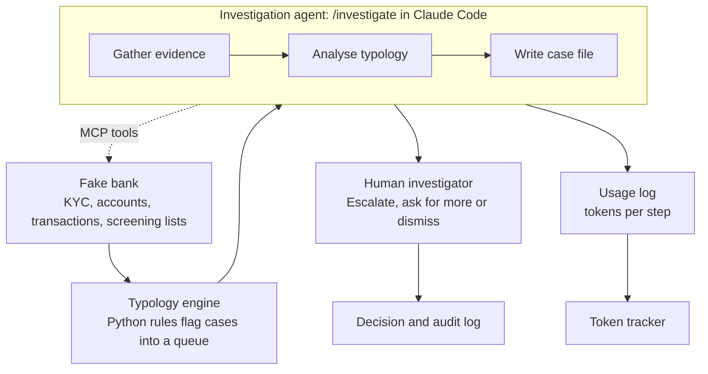

# AML Investigation Agent

An open-source AI agent that investigates anti-money-laundering (AML) alerts on a synthetic bank. Rules detect suspicious activity, the agent gathers cited evidence and drafts a case file, and a human makes every decision. Every step's token usage is logged, so you can see what each investigation costs.

> **Proof of concept. Synthetic data only.** This project is for learning and demonstration. It is not a compliance product and must not be connected to real customer data.

## How it works



Three principles hold the design together:

- **Rules detect, AI explains.** Detection is deterministic. The model only gathers evidence and writes it up.
- **Every claim is cited.** A statement in a case file without a record ID behind it is dropped.
- **A human makes every decision.** The agent suggests an action, and the person chooses.

## Project status

Early build. The plan is in [docs/DESIGN.md](docs/DESIGN.md) and the task list is in [docs/BUILD_PLAN.md](docs/BUILD_PLAN.md).

| Part | Folder | Status |
| --- | --- | --- |
| Fake bank generator | `bank/` | Done: generator and daily batch files (items 1 and 2) |
| Typology rules | `rules/` | Done: rules and answer-key tests (items 3 and 4) |
| Bank tools (MCP server) | `tools/` | Not started |
| Investigation agent | `agent/`, `.claude/` | Not started |
| Investigator review screen | `ui/` | Not started |
| Usage logging | `usage/` | Not started |
| Daily batch pipeline | `pipeline/` | Not started |
| Evaluation scorecard | `eval/` | Not started |

## Requirements

- Python 3.11 or later
- [Claude Code](https://docs.claude.com/en/docs/claude-code/overview) on a Claude subscription. No API key is needed for the proof of concept.

## Quick start

Setup steps will be added as each part is built. For now:

```bash
git clone https://github.com/SamsonOluwaseun/aml-investigation-agent.git
cd aml-investigation-agent
python -m venv .venv && source .venv/bin/activate   # Windows: .venv\Scripts\activate
pip install -r requirements.txt
```

A sample daily batch file is in [`data/sample/`](data/sample/).

## Licence

MIT. See [LICENSE](LICENSE).
