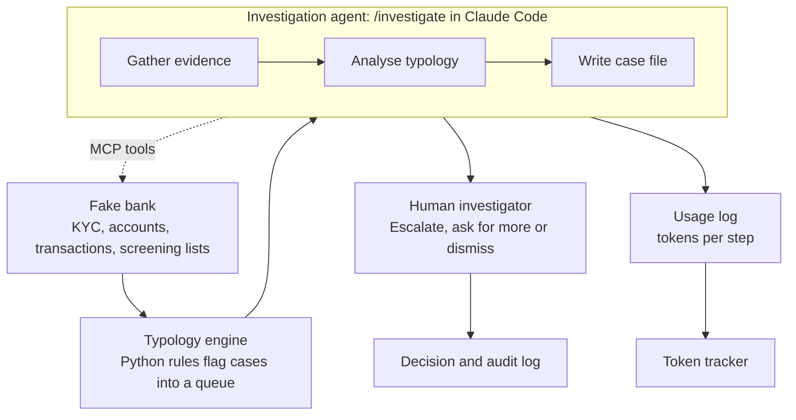
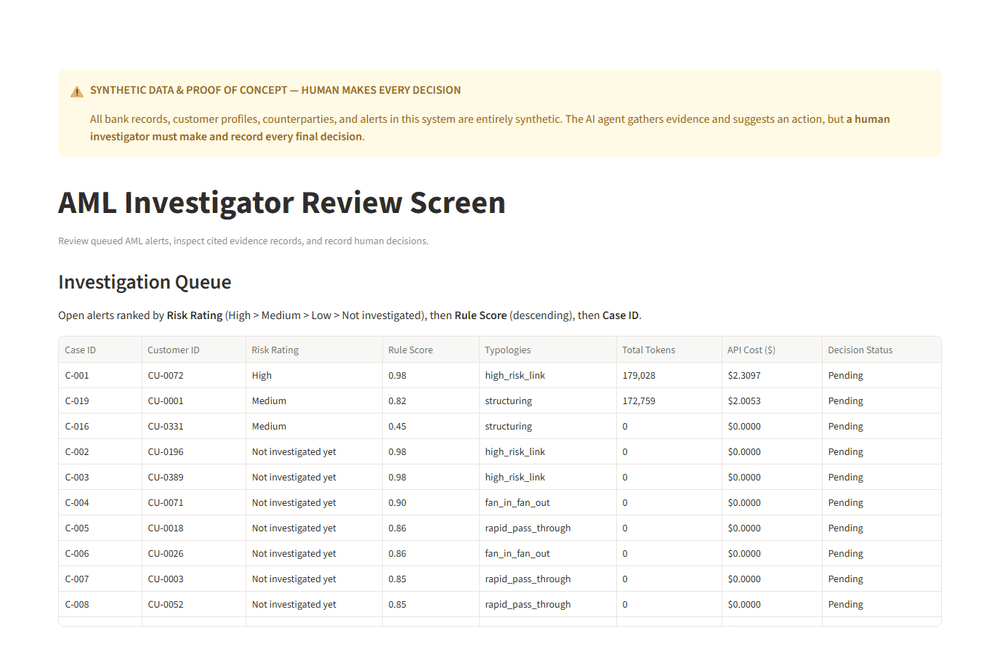

# AML Investigation Agent

An open-source AI agent that investigates anti-money-laundering (AML) alerts on a synthetic bank. Rules detect suspicious activity, the agent gathers cited evidence and drafts a case file, and a human makes every decision. Every step's token usage is logged, so you can see what each investigation costs.

> **Proof of concept. Synthetic data only.** This project is for learning and demonstration. It is not a compliance product and must not be connected to real customer data.

## How it works



Three principles hold the design together:

- **Rules detect, AI explains.** Detection is deterministic. The model only gathers evidence and writes it up.
- **Every claim is cited.** A statement in a case file without a record ID behind it is dropped.
- **A human makes every decision.** The agent suggests an action, and the person chooses.

## Project status

The build is complete: items 1 to 11 are done, apart from adding the repository topics and one interactive check of the agent. See [docs/DESIGN.md](docs/DESIGN.md) and [docs/BUILD_PLAN.md](docs/BUILD_PLAN.md).

| Part | Folder | Status |
| --- | --- | --- |
| Fake bank generator | `bank/` | Done: generator and daily batch files (items 1 and 2) |
| Typology rules | `rules/` | Done: rules and answer-key tests (items 3 and 4) |
| Bank tools (MCP server) | `tools/` | Done (item 5) |
| Investigation agent | `agent/`, `.claude/` | Done (item 6). Headless verified, interactive run to check |
| Investigator review screen | `ui/` | Done (item 9) |
| Usage logging | `usage/` | Done (item 7) |
| Daily batch pipeline | `pipeline/` | Done (item 8) |
| Evaluation scorecard | `eval/` | Done (item 10). Sample in `eval/scorecard.md` |
| Publish and present | `docs/`, `scripts/` | Done (item 11): tested setup steps, samples, demo GIF, CONTRIBUTING.md. Repo topics to add |

## Requirements

- Python 3.11 or later
- [Claude Code](https://docs.claude.com/en/docs/claude-code/overview) on a Claude subscription for investigation runs. No API key is needed for the proof of concept.

## Quick start

### 1. Clone the repository

This step needs network access.

```bash
git clone https://github.com/SamsonOluwaseun/aml-investigation-agent.git
cd aml-investigation-agent
```

### 2. Create and activate a virtual environment (offline)

Bash

```bash
python -m venv .venv
source .venv/bin/activate
```

Windows PowerShell

```powershell
python -m venv .venv
.\.venv\Scripts\Activate.ps1
```

### 3. Install the dependencies

This step needs network access to download packages.

```bash
pip install -r requirements.txt
```

On Windows, clone into a short path (for example `C:\src`). Streamlit installs some deeply nested files, and `pip` fails with `WinError 3` if the full path passes 260 characters, unless Windows long path support is enabled.

### 4. Run the tests (offline)

```bash
pytest
```

### 5. Generate the bank (offline)

```bash
python bank/generate.py
```

### 6. Run the rules (offline)

```bash
python rules/run_rules.py
```

### 7. Investigate one case (Claude Code)

Start Claude Code from the repository root with the virtual environment active.

```bash
claude
```

Enter this command in the Claude Code session.

```text
/investigate C-001
```

The draft case file appears at `cases/C-001.json`. For a headless run, use the `claude -p` form in the [agent README](agent/README.md).

### 8. Run the daily pipeline

Export three demo batches offline. Run them in date order to see the cash deposit pattern emerge on the third day.

```bash
python bank/generate.py --day 2026-11-16
python bank/generate.py --day 2026-11-17
python bank/generate.py --day 2026-11-18
```

The pipeline uses Claude Code when there is a new alert to investigate. Add `--no-agent` to each pipeline command to load the batches and run the rules offline.

```bash
python pipeline/run_daily.py --day 2026-11-16 --max-cases 1
python pipeline/run_daily.py --day 2026-11-17 --max-cases 1
python pipeline/run_daily.py --day 2026-11-18 --max-cases 1
```

### 9. Open the review screen (offline)

```bash
streamlit run ui/app.py
```

Open the local address printed in the terminal. Use another terminal with the virtual environment active for the next step, or stop Streamlit with Ctrl+C.

### 10. Build the scorecard (offline)

```bash
python eval/score.py
```

This writes the results from your local run to `eval/scorecard.md`, replacing the checked-in sample in your working copy.

## Sample outputs

See the case files and usage log from real runs on synthetic data in [docs/samples/](docs/samples/) and the [sample scorecard](eval/scorecard.md).

## Demo



The demo follows a synthetic alert from investigation to human review.

## Contributing

See [CONTRIBUTING.md](CONTRIBUTING.md) for setup and pull request guidance.

## Licence

MIT. See [LICENSE](LICENSE).
