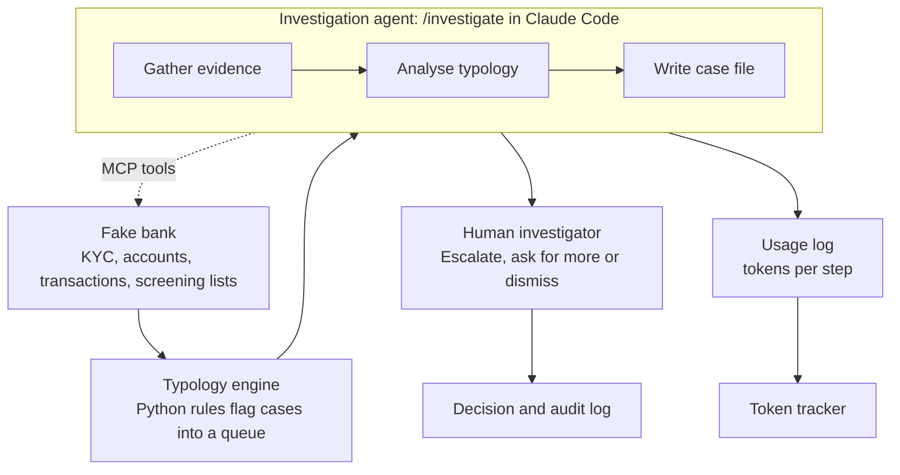

# AML Investigation Agent: step-by-step design guide

## What we're building and why

An open-source AI agent that does the evidence-gathering part of an anti-money-laundering (AML) investigation on a fake bank, hands a ranked queue of cited case files to a human, and records the token cost of every step.

AML investigation is one of the most expensive back-office jobs in banking. Most of an investigator's time goes on pulling records from several systems and writing up what they found, not on the decision itself. That is the part an agent can take on.

The project has two goals:

1. **A real agentic workflow.** Several steps, tools, subagents and a human decision point, built end to end and runnable by anyone from GitHub.
2. **A test bed for AI FinOps.** Every model call is logged with its case, step and token count. This is the first real data feed for the AI token tracker, and it shows the handoff cost that McKinsey and Gartner warn about.

Everything runs on synthetic data inside Claude Code on a normal subscription. No API key and no real customer data are needed.

## How it works



A case moves top to bottom. The agent reads the bank only through tools, and every step's tokens go to the usage log.

Three principles hold the design together:

- **Rules detect, AI explains.** Detection is deterministic. The model only gathers evidence and writes it up.
- **Every claim is cited.** A statement in a case file without a record ID behind it is dropped.
- **A human makes every decision.** The agent suggests an action, and the person chooses.

## How this maps to production

In a bank, cheap rules check every transaction in batch or near real time, and only the alerts reach an investigator. The agent stays outside the live payment path because it is too slow and too costly to run on every transaction. The PoC copies this pattern with a daily batch.

| PoC part | Production equivalent |
| --- | --- |
| Fake bank (SQLite) | Core banking, KYC and payment systems feeding a data warehouse |
| Daily batch file | Overnight extracts or a stream from payment systems |
| Typology engine | Transaction monitoring system, tuned and validated by model risk |
| Alert queue | Case management system |
| MCP tools | Read-only APIs over bank data, with access control and logging |
| Investigation agent | Same role, on approved model access inside the bank's network |
| Review screen and audit log | Case management screens and regulated record keeping |
| Usage log | AI FinOps chargeback per team and per case |

Fraud checks are different. They run in milliseconds before a payment is approved, so they are out of scope here.

### A daily batch, end to end

Each night a file of the previous day's transactions lands in `incoming/`. The sample in [`data/sample/transactions_2026-11-16.csv`](../data/sample/transactions_2026-11-16.csv) (fake data) holds a structuring pattern, a pass-through, a genuine cash business and normal activity.

`pipeline/run_daily.py` then processes it:

1. **Validate.** Check the columns, reject duplicate transaction IDs, and match the row count and total against the control file. If anything fails, reject the whole batch and raise an error.
2. **Load.** Append the rows to the transactions table and move the file to `processed/`.
3. **Run the rules over a rolling 30-day window**, not just today. CU-0231's two deposits only trigger structuring because five similar deposits arrived earlier in the fortnight.
4. **Create or update alerts.** One alert per customer. If a case is already open, add the new evidence to it rather than opening a duplicate.
5. **Run the agent on new alerts**, headless, within a daily token budget. When the budget runs out, the remaining alerts wait for the next run.
6. **Write a run summary** for the investigator and the FinOps view.

An illustrative summary for the sample batch:

```
Batch 2026-11-16 | 8 rows loaded | 0 rejected
Rules window 2026-10-18 to 2026-11-16
New alerts: 2 | Updated: 0 | Open queue: 2
  C-021  CU-0231  structuring          score 0.86
  C-022  CU-0417  rapid pass-through   score 0.78
Not flagged: CU-0302 (single deposit, declared cash business)
Agent: 2 cases investigated | tokens and cost in usage log
```

For the demo, `bank/generate.py --day 2026-11-16` writes one day's file. Run three days in a row so the audience can watch a pattern build until it crosses the threshold.

## Step 1: Set up the repo

One public GitHub repo with a folder per part, so each coding agent can own a folder without stepping on the others.

```
aml-investigation-agent/
├── bank/            # synthetic data generator + SQLite database
├── rules/           # typology engine (pure Python, no AI)
├── tools/           # MCP server exposing the bank to the agent
├── agent/           # case file schema and agent notes
├── ui/              # investigator review screen
├── usage/           # hook script + usage log
├── eval/            # scoring against the planted cases
├── pipeline/        # daily batch: validate, load, rules, agent, summary
├── data/sample/     # sample daily batch file
├── docs/            # this guide and the build plan
├── .claude/         # settings.json (hooks), agents/, skills/
├── .mcp.json        # registers the bank tools for Claude Code
├── CLAUDE.md        # rules for Claude Code
├── AGENTS.md        # rules for Codex and Antigravity
└── README.md
```

Ground rules, written into CLAUDE.md and AGENTS.md:

- Python 3.11+, SQLite, no paid services
- Every function that touches a case takes a `case_id`
- No real names, account numbers or bank data anywhere in the repo
- Each folder has its own README saying what it does and how to run it

## Step 2: Build the fake bank

Generate a small synthetic bank of about 500 customers and 6 months of transactions, with 15 laundering cases planted on purpose. The planted cases are your answer key.

| Table | What it holds | Key columns |
| --- | --- | --- |
| customers | KYC profile | customer_id, name, occupation, declared_income, risk_rating, country, onboarded_on |
| accounts | Accounts per customer | account_id, customer_id, type, opened_on, status |
| transactions | Money movement | txn_id, account_id, counterparty_account, amount_gbp, direction, channel, country, timestamp |
| counterparties | External parties | counterparty_account, name, country, bank |
| screening_list | Fake sanctions and PEP list | name, list_type, country |
| adverse_media | Short fake news snippets | name, headline, date |
| planted_cases | Answer key, hidden from the agent | case_id, customer_id, typology, notes |

How to build it:

1. Write `bank/generate.py` using Python's `random` with a fixed seed, so everyone who clones the repo gets the same bank.
2. Generate normal behaviour first: salaries in, bills and card spend out, amounts that fit each customer's declared income.
3. Inject the 15 planted cases on top (see Step 3 for the patterns). Add 10 to 15 innocent look-alikes too, such as a small business that genuinely takes lots of cash. Without these, the agent never has to tell the difference.
4. Save to `bank/bank.db` and print a short summary.

Use obviously fake names and keep the generator in the repo rather than the database, so nobody mistakes it for real data.

## Step 3: Write the typology rules

The rules decide what is suspicious. The AI never does. Plain Python rules are cheap, explainable and give the same answer every time, which is what a bank and a regulator expect.

Start with four typologies. The thresholds below are demo values, not regulatory ones.

| Typology | What it looks like | Demo rule |
| --- | --- | --- |
| Structuring | Many cash deposits kept just under a reporting threshold | 5+ cash deposits between £8,000 and £9,999 within 14 days |
| Rapid pass-through | Money arrives and leaves almost at once | 80%+ of an inbound amount sent out within 48 hours |
| Fan-in / fan-out (mules) | Many small senders into one account, or one account paying many | 10+ distinct counterparties in 7 days, out of line with history |
| High-risk link | Payments to or from a listed party or a high-risk country | Any match on the screening list, or flows to a listed country |

How to build it:

1. One function per typology in `rules/`, each returning a list of hits with `customer_id`, `typology`, `score` and the `txn_id`s that triggered it.
2. A `run_rules.py` that combines hits per customer into one alert with a total score, and writes them to an `alerts` table as the queue.
3. Unit tests that check every planted case is caught and that most look-alikes are not.

Get this step working and tested before you touch the agent. It needs no model, so it costs nothing to iterate.

## Step 4: Expose the bank as tools

Wrap the database in a small local MCP server, so Claude Code can query the bank like an investigator querying core systems. The agent sees only what the tools return. It never gets the raw database or the answer key.

| Tool | Returns |
| --- | --- |
| `list_alerts()` | Open alerts in the queue, highest score first |
| `get_alert(case_id)` | The rule hits and triggering transaction IDs |
| `get_customer(case_id, customer_id)` | KYC profile: occupation, declared income, risk rating, country |
| `get_accounts(case_id, customer_id)` | Accounts and when they were opened |
| `get_transactions(case_id, account_id, from, to)` | Transactions in a date range |
| `get_counterparties(case_id, account_id)` | Who the account pays and is paid by, with totals |
| `screen_name(case_id, name)` | Matches on the fake sanctions, PEP and adverse media lists |
| `save_case_file(case_id, json)` | Stores the finished case file for review |

How to build it:

1. Use the official MCP Python SDK in `tools/server.py`. All tools are read-only except `save_case_file`.
2. Every tool takes `case_id` as its first argument and writes one line to an audit log (case, tool, arguments, time). This gives you an evidence trail and lets the usage hook in Step 7 link tokens to cases.
3. Register it for the repo in `.mcp.json` so anyone who clones the project gets the tools automatically.
4. Cap result sizes, for example 200 transactions per call. Big tool results are the quickest way to burn tokens.

## Step 5: Build the investigation agent

The agent is a Claude Code skill called `/investigate` that runs three subagents in order and saves one cited case file per alert.

| Part | Where it lives | Job |
| --- | --- | --- |
| `/investigate` skill | `.claude/skills/investigate/SKILL.md` | Takes a case ID, runs the three subagents, checks the output, saves it |
| Evidence gatherer | `.claude/agents/evidence-gatherer.md` | Calls the bank tools and returns a tidy evidence pack |
| Typology analyst | `.claude/agents/typology-analyst.md` | Compares the evidence with the rule hits, explains the fit and lists innocent explanations |
| Case writer | `.claude/agents/case-writer.md` | Writes the case file in the fixed format below |

The case file is fixed JSON, so the UI and the evaluation can read it:

```json
{
  "case_id": "C-014",
  "customer_id": "CU-0231",
  "risk_rating": "High",
  "typologies": ["structuring"],
  "summary": "Two or three plain sentences",
  "evidence": [
    {"claim": "7 cash deposits of £8,500 to £9,900 in 12 days", "source": ["T-88120", "T-88131"]}
  ],
  "innocent_explanations": ["Declared as a market trader"],
  "gaps": ["No source of funds on file"],
  "suggested_action": "Escalate",
  "status": "Draft for human review"
}
```

Rules to write into the skill:

- Every claim cites at least one transaction or record ID. No citation means the claim is dropped.
- Always list possible innocent explanations and missing information.
- Suggest an action, but never decide. The status is always a draft.
- Do not repeat raw transaction lists in the case file. Summarise and cite.

Run one case interactively first. Once it works, run the whole queue headless, for example `claude -p "/investigate C-014"` in a loop over `list_alerts()`.

## Step 6: Build the investigator review screen

A simple local web page where a person works the queue and makes every decision. Streamlit is the quickest option in Python. Plain HTML served by FastAPI also works.

The screen needs three parts:

1. **Queue.** Open cases sorted by risk rating, then rule score, with the typology and the token cost of each case.
2. **Case view.** The summary, each evidence claim with clickable source IDs that open the underlying transactions, innocent explanations and gaps.
3. **Decision.** Escalate, Request more information or Dismiss, with a required reason. Saving writes the decision, the person and the time to a `decisions` table.

Show the agent's suggested action, but don't preselect it. The person should make a choice, not click through a default.

## Step 7: Log token usage and feed the tracker

Tokens are read from Claude Code's own records by a hook script. The agent never reports its own usage.

1. **Link sessions to cases.** A `PostToolUse` hook matched on the bank tools reads the `case_id` from each tool call and records which session and subagent were working on which case.
2. **Collect usage.** A `SubagentStop` and `Stop` hook reads the session transcript, whose path Claude Code passes to the hook, and adds up input, output and cache tokens per model response since the last run.
3. **Write one row per run** to `usage/usage.jsonl`, using the same columns as the Agent Runs sheet in the tracker spreadsheet.

| Column | Example |
| --- | --- |
| run_id | R-0412 |
| task_id (case) | C-014 |
| agent / step | evidence-gatherer |
| parent_run | R-0411 |
| model | from the transcript |
| input / output / cache tokens | 41,200 / 2,300 / 18,000 |
| started / ended | timestamps |
| evidence | transcript path |

The tracker reads that file and applies your rates to show cost per case and per step, the handoff amplification ratio (all tokens on a case ÷ tokens in the top-level run), and the week's usage against a budget. Label the cost as API-equivalent, because on a subscription you don't pay per token.

Check the Claude Code hooks documentation for the exact fields each hook receives before writing the script. Hook formats can change between versions.

## Step 8: Test and measure

The planted cases turn "it looks clever" into numbers. `eval/score.py` compares the agent's output with the answer key and prints a scorecard.

| Measure | How it is worked out | PoC target |
| --- | --- | --- |
| Catch rate | Planted cases rated High or Medium | 13 of 15 or better |
| False alarms | Look-alikes rated High | 3 or fewer |
| Citation check | Evidence claims whose source IDs exist and support the claim | 100% of IDs exist |
| Right typology | Planted cases tagged with the correct typology | 12 of 15 or better |
| Tokens per case | From the usage log | Record it, then try to bring it down |
| Handoff amplification | All tokens on a case ÷ top-level run tokens | Record it per case |

The targets are starting points for a demo, not industry benchmarks. Run the scorecard after every change to a prompt or tool, so you can see whether a change improved quality, cost or neither.

## Step 9: Split the build across Claude, Codex and Antigravity

Claude plans and reviews, Codex builds the data and rules, and Antigravity builds the screen. Each agent owns its own folders.

| Agent | Owns | Folders |
| --- | --- | --- |
| Claude Code | Orchestration, the agent, tools, usage logging, code review | `agent/`, `tools/`, `usage/`, `pipeline/`, `.claude/` |
| Codex | Synthetic bank, typology rules, evaluation | `bank/`, `rules/`, `eval/` |
| Antigravity | Investigator review screen | `ui/` |

How to run it:

1. Turn [BUILD_PLAN.md](BUILD_PLAN.md) into GitHub issues, one per piece of work, each with acceptance criteria.
2. Each agent works on a branch named after its issue, for example `issue-12-structuring-rule`. The issue number becomes the Task ID in your token tracker, so the build itself is tracked too.
3. Each piece arrives as a pull request. Claude reviews it against the acceptance criteria and you merge.

Build in this order, since each step depends on the one before: fake bank → rules and their tests → bank tools → agent → usage logging → daily pipeline → review screen → scorecard.

## Step 10: Publish on GitHub

A stranger should be able to clone the repo and see a case investigated within 15 minutes. That is the test of a good open-source README.

- [ ] README with a one-line pitch, the architecture diagram, a short demo GIF and setup in five commands or fewer
- [ ] A clear statement near the top: synthetic data only, a proof of concept, not for real compliance decisions
- [x] An open-source licence (MIT)
- [ ] Sample output committed: two or three case files and one scorecard, so people can see results without running anything
- [ ] The usage log from your own runs, showing tokens per case and the amplification ratio
- [ ] CONTRIBUTING.md with ideas for new typologies, which gives people an easy first contribution
- [ ] Check for secrets and personal details before each push
- [ ] Topics on the repo such as `ai-agents`, `aml`, `claude-code`, `mcp`, `finops`

## Presenting it to your community

Tell it as one story in about 20 minutes: an expensive job, an agent that takes the slow part, a human who keeps the decision, and a receipt for what it cost.

| Minutes | Segment | What you show |
| --- | --- | --- |
| 0 to 3 | The problem | Why AML investigation is costly, and the McKinsey and Gartner warnings on agent token spend |
| 3 to 6 | The design | The architecture diagram and the rule "AI gathers, rules detect, humans decide" |
| 6 to 12 | Live demo | Run `/investigate` on one planted case, then open the case file and click a cited transaction |
| 12 to 15 | The human step | Make a decision in the review screen and show the audit log entry |
| 15 to 18 | The receipt | Tokens per step, the amplification ratio and the scorecard |
| 18 to 20 | What's next | The repo link, how to contribute, and the token tracker as the next project |

Record the demo in advance as a backup. Live agent runs can be slow or hit usage limits at the worst moment.

## Guardrails and limitations

- **Synthetic data only.** Never connect it to real customer data. A real bank deployment would need data protection, model risk and security review first.
- **Not a compliance product.** It drafts case notes for a human. It does not file SARs or make reportable decisions.
- **Rules, not the model, decide what gets flagged.** If the rules miss a pattern, the agent never sees it.
- **Citations can still be wrong.** The scorecard checks that IDs exist, but a person must still check the claim matches the record.
- **Subscription limits.** Large queues may hit your plan's usage caps. A shared or production version would need an API key and a budget.
- **Costs are API-equivalent estimates.** On a subscription they show relative cost, not cash spent.
